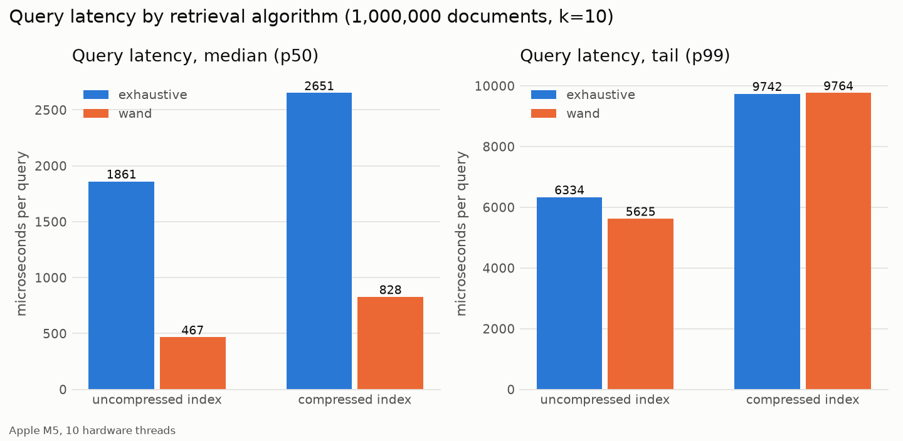
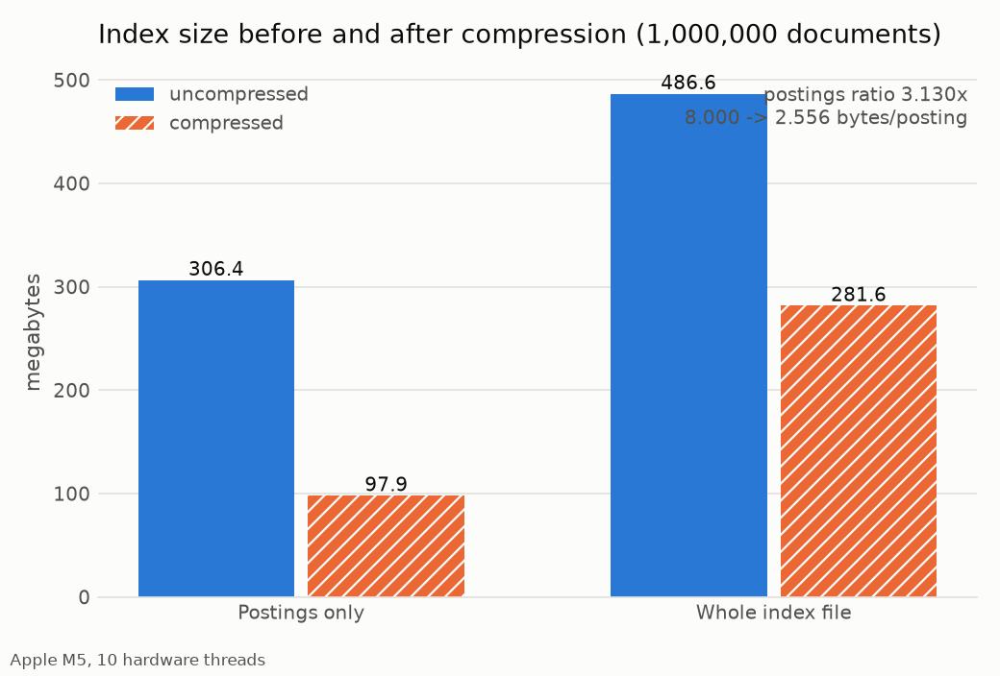
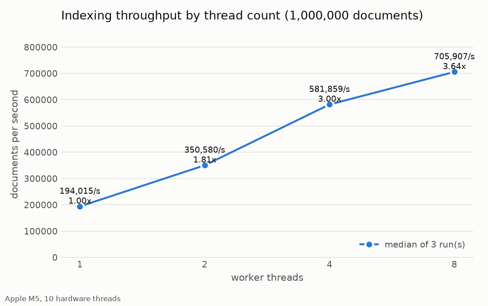
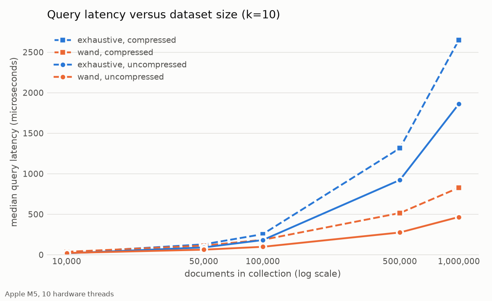
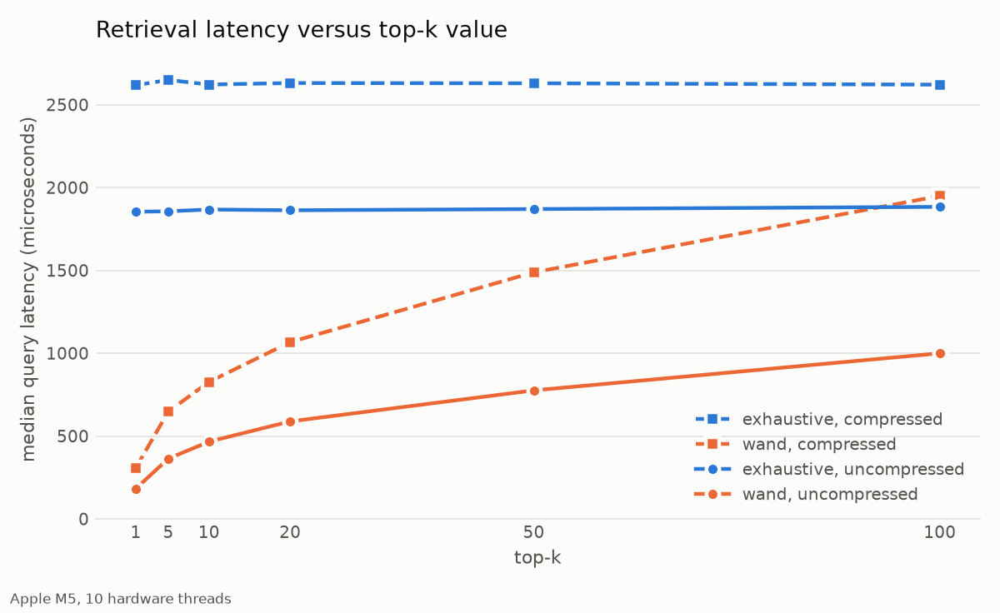

# C++ Search Engine: Full Description

A full-text search engine written from scratch in C++20: tokenizer, inverted index, Okapi BM25 ranking, delta + variable-byte posting compression, WAND top-k retrieval, multithreaded indexing, and a versioned on-disk index format. No search libraries and no external dependencies beyond the standard library (and Python/matplotlib for charts only).

The project is a study in how far a simple, correct design goes and what each optimisation actually buys. Every optimisation keeps its baseline available, and the benchmark suite reports regressions as well as wins.

## Key features

* **Tokenizer**: ASCII lowercase, punctuation stripping, optional stopwords; identical for documents and queries.
* **Inverted index**: sorted terms, flat posting array (`doc`, `tf`), document frequencies, document lengths, titles and snippets.
* **BM25** with configurable `k1`/`b` (defaults 1.2 / 0.75) and deterministic tie-breaking (higher score first, then lower document id).
* **Exhaustive baseline**: term-at-a-time accumulation plus a bounded heap.
* **Compression**: 128-posting blocks, delta-coded document ids and variable-byte integers, with per-block skip metadata.
* **WAND**: dynamic pruning with exact BM25 upper bounds; returns results bit-identical to the exhaustive baseline.
* **Parallel indexing**: thread-local partial indexes, parallel deterministic merge, output identical for any thread count.
* **Persistence**: versioned, checksummed binary format for both uncompressed and compressed indexes; corrupted or incompatible files are rejected.
* **CLI**: `index`, `search`, `interactive`, `benchmark`, `evaluate`, `info`, `serve`.
* **Web page**: a plain `web/index.html` served by a small built-in HTTP server with a JSON search endpoint.

## Architecture

```
 documents.tsv / .jsonl
          |
     document.cpp  --- parse + validate
          |
   index_builder.cpp  --- N workers: tokenize, local postings ---> merge (parallel over terms)
          |
     InvertedIndex  (baseline, uncompressed)
          |                \
          |           CompressedIndex.compress()   (delta + vbyte blocks)
          |                /
      storage.cpp  <---> index.bin  (header, checksum, dictionary, docs, postings)
          |
     SearchEngine  (variant over the two index types, same cursor interface)
        /      \
 exhaustive    WAND            both use Bm25Model::contribution(), so scores match bit for bit
        \      /
        TopK heap ---> ranked results
```

| File | Role |
|---|---|
| `tokenizer`, `document` | normalisation, TSV/JSONL loading, snippets |
| `inverted_index` | `IndexCore` (dictionary, df, doc stats), `InvertedIndex`, `VectorCursor` |
| `compression`, `compressed_index` | codecs, block layout, `CompressedCursor`, `CompressedIndex` |
| `bm25`, `wand` | scoring model, exhaustive search, WAND |
| `index_builder` | single/multi-threaded construction |
| `storage` | binary format |
| `search_engine`, `evaluation` | facade, MRR@k / Recall@k |
| `benchmark` | latency percentiles, peak RSS, CSV |

Retrieval algorithms are templates over an index type that provides `core()` and `cursor(term)`. A cursor exposes `valid() / doc() / tf() / next() / next_geq()`, so the same algorithm code runs over both storage layouts and the comparison isolates the storage format.

## BM25

```
idf(t)       = ln(1 + (N - df + 0.5) / (df + 0.5))
score(q, d)  = sum over unique t in q of  idf(t) * tf * (k1 + 1) / (tf + k1 * (1 - b + b * len(d) / avgdl))
```

The `ln(1 + x)` form (as used by Lucene) never goes negative, which WAND requires because its upper bounds assume non-negative contributions.

Policies:

* **Duplicate query terms** count once.
* **Unknown terms** are ignored; a query with no known term returns no results, as does an empty query or `k = 0`.
* **Ties** break by ascending internal document id (the order of the input file).
* Scores are `double`. The build uses `-ffp-contract=off` and both algorithms sum contributions in ascending term-id order so equal documents get exactly equal scores in both.

## Compression

Each posting list is split into blocks of 128 postings. A block stores the document-id gaps (delta coding, the first gap is relative to the previous block's last id) followed by the term frequencies, all as variable-byte integers (7 bits per byte, high bit = continuation). A block table holds `(last_doc, byte_offset)` per block. The compressed cursor decodes one block at a time, finds the right block for `next_geq` with a binary search over `last_doc`, and decodes term frequencies lazily, only for documents that are actually scored.

Compressed lists are fully validated when an index is loaded (bounds, strictly increasing ids, ids below the document count, tf >= 1), so the hot decoding path needs no bounds checks.

## WAND

Per-term upper bounds are the exact maximum BM25 contribution over the term's postings (computed once when an engine is created, inflated by 1e-9 for floating-point safety). Cursors are kept sorted by current document; the pivot is the first cursor where the cumulative bound exceeds the current top-k threshold. If all cursors before the pivot are already on the pivot document it is fully scored, otherwise one cursor is advanced with `next_geq(pivot_doc)`. Documents are visited in increasing id order, so a document that only ties the current k-th score can never displace it, which makes the strict `>` pruning test exact, including ties. Differential tests confirm identical output to the exhaustive baseline.

## Multithreading

`build_index` splits the documents into one contiguous range per worker. Each worker tokenizes its range and fills a private `unordered_map<term, postings>` (no locks). The merge builds the sorted global vocabulary, then runs two parallel passes over disjoint term ranges: count document frequencies, then copy each term's per-worker lists, in worker order, to their final offsets in one flat array. Because the ranges are contiguous and ascending, concatenation keeps lists sorted with no further sorting. Workers are plain `std::thread`s, one set per phase (not one per document). The output is byte-identical to the single-threaded build (verified by tests and by comparing the saved files).

## Build and test

Requires a C++20 compiler and CMake 3.16+. Tested with Apple clang 21 on macOS; GCC/Clang on Linux should work (nothing platform specific except the peak-RSS and hardware-description helpers, which have Linux branches).

```bash
cmake -S . -B build -DCMAKE_BUILD_TYPE=Release
cmake --build build -j
ctest --test-dir build --output-on-failure
```

Optional: `-DSE_SANITIZE=ON` (ASan + UBSan; all tests pass under it), `-DSE_NATIVE=ON` (`-march=native`).

The tests use a small built-in framework (`tests/test_util.h`) to avoid a dependency. They cover: tokenization, document parsing errors, postings and frequencies, BM25 against independently computed values (including a Python-computed fixture), tie-breaking, compression round trips and cursor skipping, WAND vs exhaustive on random collections (both backends, many `k`, non-default BM25 parameters, heavy ties), 1 to 16-thread build equivalence, save/reload result equality, header/body corruption, truncation and structurally invalid but correctly checksummed files, and the CLI.

## CLI

```bash
./build/search_engine index --input data/sample/documents.tsv --output data/index.bin --threads 4
./build/search_engine search --index data/index.bin --query "efficient machine learning" --topk 3
./build/search_engine interactive --index data/index.bin
./build/search_engine benchmark --index data/index.bin --queries data/sample/queries.tsv --output results/benchmark.csv
./build/search_engine evaluate --index data/index.bin --queries data/sample/queries.tsv --qrels data/sample/qrels.tsv
./build/search_engine info --index data/index.bin
```

Example output:

```
Query: efficient machine learning

1. Doc 10 | Score: 4.1426 | Efficient search
2. Doc 2 | Score: 2.6369 | Deep learning
3. Doc 1 | Score: 2.4301 | Machine learning basics

(3 result(s) in 0.005 ms, wand, compressed index)
```

`index --compression none` stores uncompressed postings; `--stopwords` removes stopwords. Run `./build/search_engine --help` for all options. Invalid options, missing files, malformed inputs and corrupt indexes produce a message and a non-zero exit code.

## Web UI

```bash
./build/search_engine serve --index data/index.bin --port 8080
```

Open `http://127.0.0.1:8080/`. The page (`web/index.html`, plain HTML, CSS and a few lines of JavaScript) calls `GET /api/search?q=...&k=10`, which returns JSON with the query time and, for each hit, `id`, `score`, `title` and `snippet`. The server (`src/http_server.cpp`) is a small dependency-free HTTP/1.1 implementation on POSIX sockets: GET only, request headers capped at 8 KB, 5 s socket timeouts, at most 64 concurrent connections, and queries limited to 512 bytes and `k` to 100. Search calls are serialised with a mutex because `SearchEngine` is not thread safe. It binds to `127.0.0.1` by default; `--host 0.0.0.0` exposes it to the network, but there is no TLS, authentication or rate limiting, so it is meant for local demos rather than public hosting.

## Dataset

See [`data/README.md`](data/README.md) for input formats and for downloading MS MARCO passages and building 100k / 1M subsets. Nothing large is committed; `data/sample/` is a ten-document fixture.

## Benchmark methodology

* Hardware: Apple M5, 10 hardware threads, 16 GB RAM, macOS, Apple clang 21, `-O3`, single-threaded queries.
* Data: MS MARCO passages, a 1,000,000-passage subset (all dev-small relevant passages plus a seeded random sample) in shuffled order; smaller sizes are prefixes of the same file. Queries are the MS MARCO dev-small queries (first 2,000 used for latency).
* Latency: per-query wall time (`steady_clock`) around `search_ids`; 100 warmup queries, then 2 passes over the 2,000 queries = **4,000 measured queries** per configuration, k = 10 unless stated. All four configurations (exhaustive/WAND x uncompressed/compressed) use the same indexes' contents, queries and thread. Percentiles are nearest-rank.
* Before measuring each index, every query is run with both algorithms and the results are compared; the run fails on any difference. The result was: identical for every query at every size and k.
* Indexing: one process per measurement (so peak RSS is meaningful), 3 runs per thread count; times exclude file loading. "Peak RSS" is the process high-water mark and includes the ~500 MB of loaded document text.
* Retrieval quality is evaluated separately (below), never during latency runs.
* Reproduce: `scripts/run_benchmarks.sh data/msmarco_1m/documents.tsv data/msmarco_1m/queries.tsv results 10000,50000,100000,500000,1000000` (with `MAX_QUERIES=2000 REPEATS=2` as used here), or the individual commands in `benchmarks/`. The CSVs and charts in `results/` were produced by exactly this.

## Results

All numbers below are from the CSV files in `results/`. One machine, one run configuration: treat small differences as noise.

### Query latency (1,000,000 passages, k = 10, 4,000 measured queries)

| Index | Algorithm | p50 | p95 | p99 | QPS (1 / mean latency) |
|---|---|---|---|---|---|
| uncompressed | exhaustive | 1861 us | 5852 us | 6334 us | 424 |
| uncompressed | WAND | **467 us** | 3083 us | 5625 us | 1121 |
| compressed | exhaustive | 2652 us | 8379 us | 9742 us | 298 |
| compressed | WAND | 828 us | 5451 us | 9764 us | 627 |

* WAND scores ~3,400 documents per query on average instead of ~561,000 and cuts median latency about 4x (uncompressed) and 3.2x (compressed). Its advantage in the tail is much smaller: queries made only of common terms cannot be pruned much, so p99 is close to the exhaustive baseline (and equal on the compressed index).
* Compression costs query time: ~1.4x at the median for exhaustive, ~1.8x for WAND. The index is 3x smaller, not faster.
* WAND is a **regression at small sizes**: at 10,000 documents its median is 22 us vs 18 us for exhaustive (37 vs 26 us compressed), because the pivot bookkeeping costs more than scoring a few thousand documents. It breaks even somewhere below 50,000 documents (63 vs 91 us) and the gap widens with collection size (chart 4).

### Top-k sweep (1M passages, uncompressed, p50)

| k | 1 | 5 | 10 | 20 | 50 | 100 |
|---|---|---|---|---|---|---|
| WAND | 173 us | 352 us | 454 us | 561 us | 785 us | 1016 us |
| exhaustive | 1883 us | 1877 us | 1879 us | 1871 us | 1897 us | 1930 us |

WAND slows down as k grows because the pruning threshold rises more slowly; exhaustive is flat. On the compressed index at k = 100, WAND p50 is 1923 us vs 2663 us for exhaustive, so the advantage has mostly gone.

### Compression

| Documents | Postings | Raw postings | Compressed | Ratio | Bytes/posting | Index file (raw -> compressed) |
|---|---|---|---|---|---|---|
| 100,000 | 4.03 M | 30.6 MB | 10.3 MB | 2.96x | 8.00 -> 2.70 | 49.8 -> 30.5 MB |
| 1,000,000 | 40.2 M | 306.4 MB | 97.9 MB | 3.13x | 8.00 -> 2.56 | 486.6 -> 281.6 MB |

Median of 5 runs at 1M documents: encoding 202 M postings/s (1.54 GB/s of raw postings), decoding 465 M postings/s (3.55 GB/s). The whole-file ratio is lower (1.73x) because the document metadata and dictionary (titles, snippets, terms) are not compressed. Round trips were verified for every size.

### Indexing throughput (1M documents, median of 3 runs)

| Threads | Time | Docs/s | Speedup | Peak RSS |
|---|---|---|---|---|
| 1 | 5.15 s | 194,000 | 1.00x | 1.52 GB |
| 2 | 2.85 s | 351,000 | 1.81x | 1.55 GB |
| 4 | 1.72 s | 582,000 | 3.00x | 1.58 GB |
| 8 | 1.42 s | 706,000 | 3.64x | 1.63 GB |

Scaling flattens at 8 threads: the machine has a mix of performance and efficiency cores, the vocabulary merge/sort and the `InvertedIndex` validation pass are serial, and memory allocation contends. Peak memory grows only slightly with thread count because partial indexes replace, rather than add to, the final index.

### Retrieval quality (100,000-passage subset, all 6,980 dev-small queries)

| Algorithm | MRR@10 | Recall@10 |
|---|---|---|
| exhaustive | 0.6430 | 0.8018 |
| WAND | 0.6430 | 0.8018 |

These are **not comparable to the official MS MARCO leaderboard**: the subset has about 1% of the passages, so there are far fewer distractors, and plain BM25 on the full collection scores around 0.18 MRR@10 in the literature. The numbers only show that ranking quality is sensible and identical across algorithms and index formats.

### Charts







## Trade-offs

* **Compression vs memory vs latency**: variable-byte with blocks gives ~3x smaller postings, but decoding adds CPU work and cache traffic, so every query got slower (1.4x to 1.8x median). If the index fits in RAM this is a pure loss for latency; it pays off for disk footprint, load time, and indexes larger than memory. Faster SIMD codecs (e.g. bit-packing) would narrow the gap.
* **WAND vs exhaustive**: a large median win that grows with collection size and shrinks with k and with common-term queries. It costs an upper-bound scan when the engine starts (one pass over all postings) and a more complex implementation. The exhaustive baseline here is already strong (dense accumulator, no hashing), which makes the WAND win more meaningful than against a naive baseline.
* **Indexing speed vs memory**: thread-local maps avoid locks but duplicate each term string per worker until the merge; hash lookups are done twice in the merge to avoid keeping pointer tables.
* **Block size** (128) trades skip granularity against metadata (8 bytes per block) and decode amount per skip. It was not tuned.

## Limitations and future work

* Tokenizer is English/ASCII only: non-ASCII bytes are separators (`cafe` with an accent splits), no stemming, no phrase or proximity search, apostrophes inside words are dropped (`don't` -> `dont`), tokens longer than 64 characters are dropped.
* Immutable index; no incremental updates or deletions.
* Whole index files are read into memory and checksummed at load (no memory mapping); loading a compressed index also validates every list. Upper bounds are recomputed at startup.
* A `SearchEngine` is not thread safe (it owns query scratch space). Queries are benchmarked single-threaded; the web server serialises searches behind a mutex.
* Term and document ids are 32-bit; individual compressed posting lists are limited to 4 GB.
* The latency benchmarks were run once on one machine with a laptop-class chip; absolute numbers will differ elsewhere. A single process ran the whole latency suite, so allocator/cache state is shared between configurations.
* Possible next steps: block-max WAND / MaxScore, SIMD bit-packing (PForDelta, SIMD-BP128), memory-mapped loading, stemming, positional indexes.
